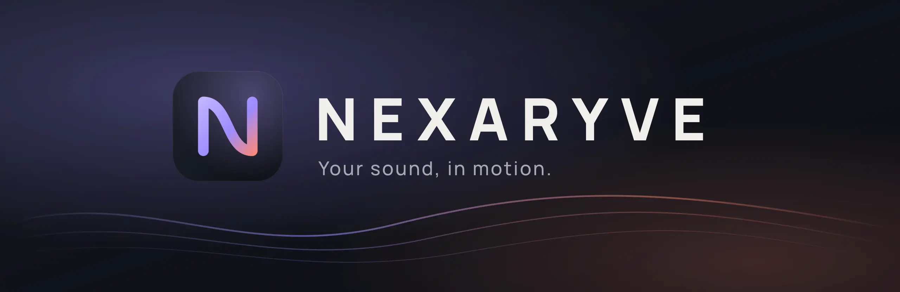
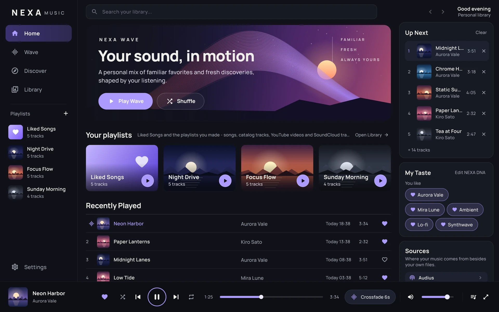
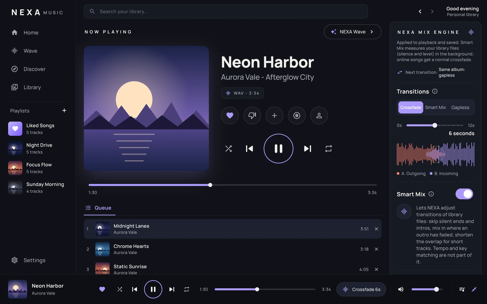
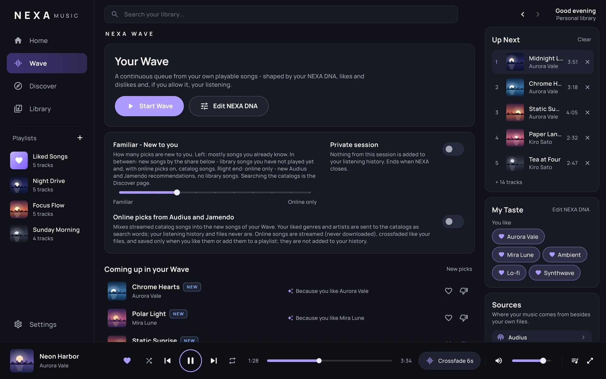
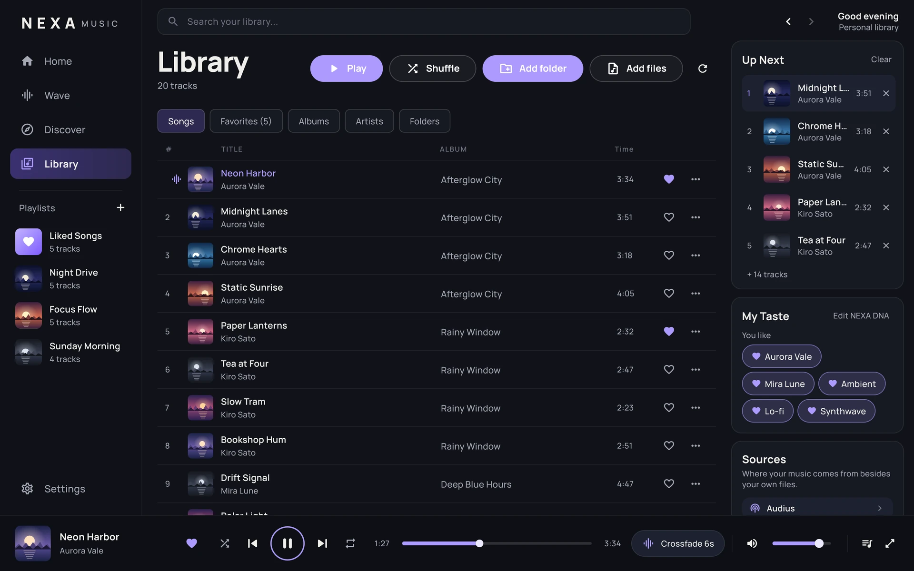
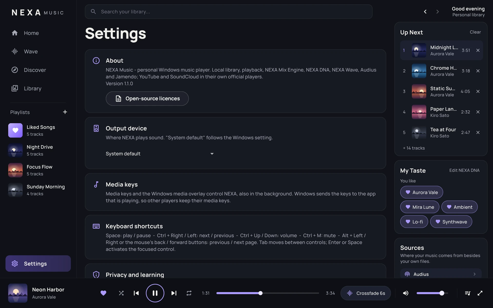

<p align="center">
  
</p>

<p align="center">
  <a href="https://github.com/KondexOFF/Nexa-Music/releases/tag/v1.1.0"></a>
  
  
  
  
</p>

<p align="center">
  <b>A private, beautiful music player for Windows.</b> <sub>(formerly NEXA Music)</sub><br>
  Your own library, mixed like a DJ set — plus Audius, Jamendo, YouTube and SoundCloud in one queue.
</p>

<p align="center">
  <a href="#-download">Download</a> ·
  <a href="#-highlights">Highlights</a> ·
  <a href="#-a-closer-look">Screenshots</a> ·
  <a href="#-sources">Sources</a> ·
  <a href="#-privacy">Privacy</a> ·
  <a href="#-build-from-source">Build</a> ·
  <a href="#-quality">Quality</a>
</p>

<br>

<p align="center">
  
</p>

## ✦ Highlights

<table>
  <tr>
    <td width="33%" valign="top">
      <h3>🎚️ NEXARYVE Mix Engine</h3>
      Gapless playback and equal-power crossfades from 0 to 12 seconds. <b>Smart Mix</b> measures every song of your library once, in the background, and mixes past silent tails and faded outros.
    </td>
    <td width="33%" valign="top">
      <h3>🌊 NEXARYVE Wave</h3>
      An endless queue shaped by your taste — from <i>Familiar</i> to <i>Online only</i>. Every pick tells you why it is there; a disliked song leaves your Wave.
    </td>
    <td width="33%" valign="top">
      <h3>🧬 NEXARYVE DNA</h3>
      Pick genres and artists you love, like and dislike songs. Your taste profile is explicit, editable and stays on your PC.
    </td>
  </tr>
  <tr>
    <td width="33%" valign="top">
      <h3>🔗 One queue for everything</h3>
      Library songs, Audius and Jamendo streams, YouTube videos and SoundCloud tracks — one after another, in one queue that survives a restart.
    </td>
    <td width="33%" valign="top">
      <h3>📚 Your library, untouched</h3>
      MP3, FLAC and WAV from your own folders. Tags, covers, albums, artists, playlists and favorites. Files are never copied, moved or deleted.
    </td>
    <td width="33%" valign="top">
      <h3>🪟 Made for Windows</h3>
      Media keys and the Windows media overlay, output-device choice, mini player on top of other windows, keyboard shortcuts, remembered window size.
    </td>
  </tr>
</table>

## ✦ A closer look

<table>
  <tr>
    <td width="50%"></td>
    <td width="50%"></td>
  </tr>
  <tr>
    <td align="center"><b>Now Playing</b> · the Mix Engine explains every transition</td>
    <td align="center"><b>NEXARYVE Wave</b> · from familiar to brand-new, with “why this song”</td>
  </tr>
  <tr>
    <td width="50%"></td>
    <td width="50%"></td>
  </tr>
  <tr>
    <td align="center"><b>Library</b> · songs, favorites, albums, artists, folders</td>
    <td align="center"><b>Settings</b> · output device, media keys, privacy, backups</td>
  </tr>
</table>

<sub>Screenshots of the real app with a demo library — song and artist names are invented.</sub>

## ✦ Sources

Every source is used the way its owner allows — through official APIs and official players.

| Source | Plays in NEXARYVE | Search | Crossfade | NEXARYVE Wave | Likes & playlists |
|---|:---:|:---:|:---:|:---:|:---:|
| **Your files** (MP3 · FLAC · WAV) | ✅ | ✅ | ✅ Smart Mix | ✅ | ✅ |
| **Audius** | ✅ stream | ✅ | ✅ | ✅ | ✅ |
| **Jamendo** (your free client id) | ✅ stream | ✅ | ✅ | ✅ | ✅ |
| **YouTube** — official player | ✅ visible player | 🔑 own API key | — | — | ✅ |
| **SoundCloud** — official widget | ✅ tracks, sets, profiles | ↗ soundcloud.com | — | — | ✅ |

Spotify is not an audio source. YouTube and SoundCloud audio stays inside their own players: no downloads, no background tricks, no mixing — that is their rule, and NEXARYVE keeps it. Details and every known limit: [RELEASE_NOTES.md](RELEASE_NOTES.md) and [reports/FEATURE_COMPLETE_REPORT.md](reports/FEATURE_COMPLETE_REPORT.md).

## ✦ Download

1. Download **`NEXA_Music_1.1.0_Windows_x64.zip`** from the [v1.1.0 release](https://github.com/KondexOFF/Nexa-Music/releases/tag/v1.1.0) and check it against `SHA256SUMS.txt`.
2. Unpack the folder anywhere and start **`nexa_music.exe`** — no installer, the Visual C++ runtime is included.
3. **Library → Add folder** with your music. That's it.

> [!NOTE]
> The exe is not code-signed, so Windows SmartScreen may ask once: *More info → Run anyway*.
> Your library, playlists and settings live in `%APPDATA%\com.kondexoff\nexa_music`, not in the program folder — updating NEXARYVE keeps them, and the database is backed up before every upgrade.

<details>
<summary><b>Keyboard shortcuts</b></summary>
<br>

| Keys | Action |
|---|---|
| <kbd>Space</kbd> | Play / pause |
| <kbd>Ctrl</kbd> + <kbd>→</kbd> / <kbd>←</kbd> | Next / previous song |
| <kbd>Ctrl</kbd> + <kbd>↑</kbd> / <kbd>↓</kbd> | Volume up / down |
| <kbd>Ctrl</kbd> + <kbd>M</kbd> | Mute |
| <kbd>Alt</kbd> + <kbd>←</kbd> / <kbd>→</kbd>, mouse back / forward | Previous / next page |
| Media keys | Work in the background, without taking the keys from other players |

</details>

## ✦ Privacy

- **Your data stays on your PC.** Library, history, taste profile and keys are stored only locally; only your searches go to the catalogs you use.
- **History only with your consent** — pause learning or use a private session at any time; delete it in one click.
- **Online picks send only words** — your liked genres and artists, never your files or history.
- **Optional ad blocking** in the web players (off by default, your own uBlock Origin Lite, removable in one click — no guarantees, and it goes against YouTube's API policies).

## ✦ Build from source

Verified environment: Windows 11 x64 · Flutter 3.47.7 / Dart 3.13.5 · Visual Studio 2022 with *Desktop development with C++* · Windows Developer Mode on.

```powershell
flutter pub get
flutter analyze
flutter test
flutter build windows --release   # → build\windows\x64\runner\Release\ (copy the whole folder)
```

<details>
<summary><b>Under the hood</b></summary>
<br>

| Layer | Technology |
|---|---|
| UI | Flutter (Windows), Manrope, own design system (NEXA Design 04) |
| State | Riverpod 3 |
| Data | Drift / SQLite, safe migrations with automatic backups |
| Audio | media_kit / libmpv — two decks for gapless and crossfade, a separate silent decoder for Smart Mix analysis |
| Web players | Microsoft Edge WebView2 (official YouTube IFrame Player, SoundCloud widget) |
| Windows | Media controls (SMTC), native mini window, window placement |

```
lib/
├─ app/            shell, navigation, theme, strings
├─ core/           audio engine, database, models, settings
├─ features/       home · library · player · mix_engine · nexa_dna · nexa_wave
│                  discover · youtube · soundcloud · privacy
├─ integrations/   Audius, Jamendo, YouTube, SoundCloud adapters
└─ ui/             shared widgets
```

</details>

## ✦ Quality

| | |
|---|---|
| **Unit & widget tests** | 293 passing (`flutter test`) |
| **Integration tests** | real media_kit / libmpv, SQLite, WebView2, YouTube and SoundCloud players |
| **NEXARYVE AutoTest** | 30 / 30 scenarios, 66 / 66 checks on the 1.1.0 release build — sound measured through WASAPI loopback, the Release exe driven through UI Automation, media keys, migration, crash log |
| **Release check** | the published ZIP was downloaded again and compared file by file with the tested build |

Run it yourself: double-click `NEXA_AutoTest.cmd` (test tones are played; your own library is never touched). Reports: [RELEASE_1.1.0_READINESS.md](reports/RELEASE_1.1.0_READINESS.md) · [FINAL_AUTOTEST_REPORT.md](reports/FINAL_AUTOTEST_REPORT.md).

## ✦ Roadmap

- **Windows 1.1** — released ✔
- **Ports** — macOS, Linux, Android, iOS / iPadOS and Web, behind the same adapters ([docs/ARCHITECTURE.md](docs/ARCHITECTURE.md))

## ✦ People

| Who | Role |
|---|---|
| **KondexOFF** | Project owner: idea, plan, decisions, acceptance and releases |
| **Claude** (AI by Anthropic) | Implementer and tester: code, tests, NEXARYVE AutoTest and the Windows checks; assistant to the owner |
| **ChatGPT** (AI by OpenAI) | Design and technical reviewer of the phase reports |

Claude works only on the owner's instructions; every phase, push and release is the owner's decision ([CLAUDE.md](CLAUDE.md)).

<details>
<summary><b>Rules for this repository</b></summary>
<br>

- Plan: [NEXA_Music_Master_Plan_Claude.md](NEXA_Music_Master_Plan_Claude.md) · agent rules: [CLAUDE.md](CLAUDE.md) · decisions: [docs/DECISIONS.md](docs/DECISIONS.md) · change requests: [docs/CHANGE_REQUESTS.md](docs/CHANGE_REQUESTS.md) · progress: [docs/PROGRESS.md](docs/PROGRESS.md) · reports: [reports/](reports/)
- Never commit music files, databases, listening history, keys / client ids, tokens or personal paths.
- Every push to GitHub needs the owner's permission.

</details>

## ✦ License

**Copyright © 2026 KondexOFF. All rights reserved.**
No licence is granted — copying, distributing or reusing this code needs the owner's written permission. Third-party components keep their own licences (listed in the app under *Settings → Open-source licences*). See [LICENSE](LICENSE).

<p align="center"><sub>NEXARYVE · made for listening, not for scrolling.</sub></p>
