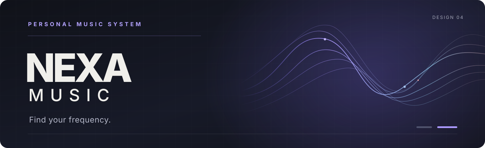

<a href="../README.md">English</a>

# Музыка, которая ощущается твоей

**NEXA Music** — личный музыкальный плеер с локальной библиотекой, плавными переходами и рекомендациями, которые можно понять и настроить. В основе — спокойный интерфейс NEXA Design 04: графитовые поверхности, мягкий лавандовый акцент и ничего лишнего.

Проект разрабатывается для личного использования. Основная платформа сейчас — **Windows**; мобильные системы, macOS, Linux и браузер входят в дальнейшие планы.

## Что задумано

| Модуль | Назначение |
| :-- | :-- |
| **Библиотека** | Импорт MP3, FLAC и WAV, поиск, избранное, плейлисты и офлайн-доступ. |
| **Mix Engine** | Gapless и настраиваемый Crossfade для совместимых источников. |
| **NEXA DNA** | Явные предпочтения и история прослушивания под контролем пользователя. |
| **NEXA Wave** | Персональная очередь с объяснением рекомендаций. |
| **Источники** | Доступ к разрешённым онлайн-каталогам с учётом правил воспроизведения. |

## Где находится разработка

- **Этап 0** — аудиопрототип Windows подтверждён и принят: [`phase/00-review`](https://github.com/KondexOFF/Nexa-Music/tree/phase/00-review).
- **Этап 1** — интерфейс Home и Now Playing реализован в [`phase/01-review`](https://github.com/KondexOFF/Nexa-Music/tree/phase/01-review); окончательная ручная приёмка отложена.
- **Этапы 2–5** — по рабочему журналу реализованы локально, но ветка `dev/v1` пока не опубликована в GitHub.
- **Этапы 6–7 и финальная проверка** — впереди.

Это **рабочая альфа-версия**, а не готовый релиз. Ветка `main` пока содержит документацию проекта; исходники доступного Windows-превью находятся в `phase/01-review`.

## Где смотреть дальше

- [Подробный план и статус этапов](ROADMAP.md)
- [Архитектура](ARCHITECTURE.md)
- [Дизайн](DESIGN.md)
- [Решения по проекту](DECISIONS.md)
- [Отчёт этапа 0](https://github.com/KondexOFF/Nexa-Music/blob/phase/00-review/reports/PHASE_00_REPORT.md)
- [Отчёт этапа 1](https://github.com/KondexOFF/Nexa-Music/blob/phase/01-review/reports/PHASE_01_REPORT.md)

Локальная музыка остаётся под контролем владельца. Доступ к онлайн-каталогам зависит от лицензий и правил конкретного сервиса. В репозитории нет музыкальных файлов, ключей доступа и личной истории прослушивания.
